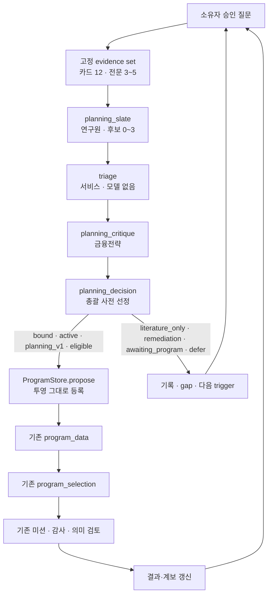
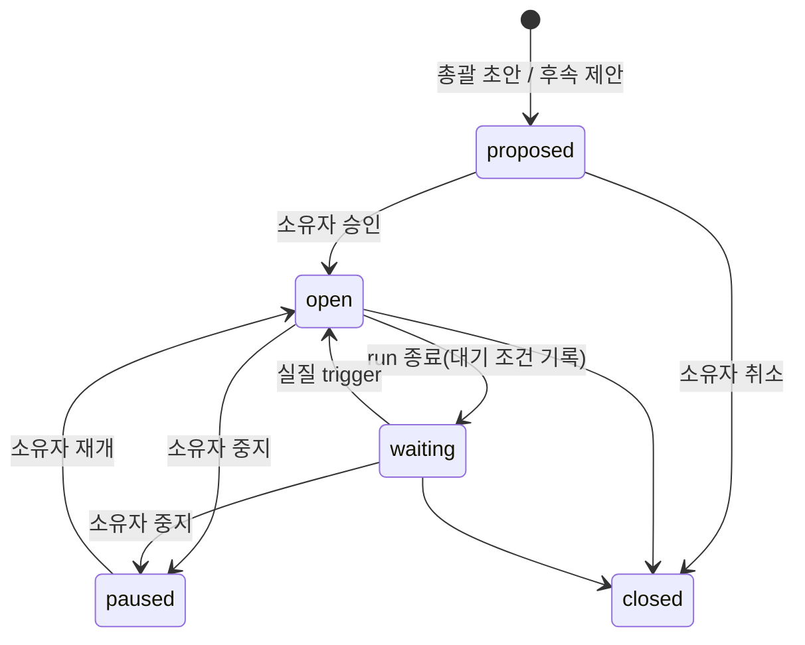

# 연구 계획 계층 설계 v2

- 작성일: 2026-10-13 KST
- 대상: quant-ai-company의 연구 질문 → 근거 선정 → 후보 비교 → 프로그램 연결 기능
- 구현 주체: 이 저장소에서 Claude 세션이 진행한다. 초안의 Codex 착수 지시는 폐기한다.
- 문서 상태: 설계다. 구현 완료, 운영 배포, 새 과학 실험의 승인 기록이 아니다.
- 대체 대상: 사용자 초안 `docs/project/QUANT_AI_COMPANY_RESEARCH_DESIGN_20261013.md`
  (메인 체크아웃의 미추적 파일). 초안과 무엇이 달라졌는지는 부록 A에 있다.

## 0 한눈에 보기

**바뀌는 것**
- 연구원이 최근 20건 문헌에서 과제를 하나씩 제안하던 방식을 바꾼다.
- 새 방식: 소유자가 승인한 **연구 질문**에 맞춰 근거 묶음을 고정한다. 그 위에서 후보 0~3개를 비교하고, 고른 후보를 기존 프로그램 과제로 **그대로** 등록한다.

**핵심 결정**
1. 프로그램에 묶인 계획 run은 `program_proposal`을 대체한다. 이중으로 실행하지 않는다.
2. 데이터·평가기 적합성은 모델 없이 서비스가 기존 `ProgramStore` 검증으로 미리 판정한다(triage).
3. 원문 완독 규칙(ADR 0037)은 유지한다. 대신 읽을 수 있는 범위를 글자 수 예산으로 제한한다.
4. 기존 실행 기반을 재사용한다: `research_stage` task, 단계 테이블, 네이티브 응답 계약.
5. shadow가 먼저다. 운영 중인 프로그램에는 비교만 한다.

**사용자 결정 (2026-10-13)**
- 코드 구현은 PR #105가 main에 반영된 뒤 시작한다. 10-13 PR #138(#87·#105 포함)로 반영됐다.
- 운영 중인 프로그램 `f7deaf96`에는 shadow 비교만 하고, 전환은 따로 결정한다.
- 목적 검색 문서는 내부 연구용으로만 쓴다.
- 후속 질문은 소유자가 활성화한다.

**순서**: P0 기준 재확인 → P1 모델 호출 없는 기반 → P2 shadow 직원 단계 → P3 프로그램 연결 → P4 목적 검색과 환류.

## 1 목표와 범위

완료되면 시스템은 다음 질문에 근거를 붙여 답해야 한다. 초안의 질문을 유지한다.

1. 지금 무엇을 연구하며, 왜 그 질문이 먼저인가?
2. 어떤 원문과 반대 근거를 읽었고, 무엇을 아직 확인하지 못했는가?
3. 후보 A와 B 중 A를 고른 이유는 무엇인가?
4. 현재 데이터·평가기·체결 조건으로 무엇까지 검증할 수 있는가?
5. 무엇 때문에 보류됐고, 누가 어떤 증거를 확보하면 다시 검토하는가?
6. 실험 결과가 다음 질문을 어떻게 바꿨는가?

결과는 세 종류로 나누어 표시한다. 서로 바꿔 해석하지 않는다.

| 결과 | 의미 | 금지할 해석 |
| --- | --- | --- |
| 문헌·방법론 정리 | 원문에 근거해 가설·방법·한계를 정리함 | 재현 성공, 수익성 검증 |
| 실행 준비 | 데이터·평가기·승인 범위에 맞는 과제를 등록함 | 실험 성공, 전략 채택 |
| 실험·검토 완료 | 실제 산출물과 감사·해석 결과가 있음 | 개발 결과를 확증·실거래 성과로 표시 |

**이번 범위에서 하지 않는 것**
- 학습, 백테스트, 실거래 연결.
- 새 유료 검색 API, 벡터 DB, 웹 UI.
- 승인된 프로그램·미션 명세와 digest의 소급 변경.
- 미션 내부 가설 cycle(proposal/challenge/selection)의 변경.
- 계보 없는 legacy v1 미션의 컨텍스트 보강.
- 운영 프로그램의 planning_v1 전환. 이것은 shadow 결과를 본 뒤 소유자가 별도로 결정한다.

## 2 기준 코드와 운영 사실

### 2.1 코드 기준

- 이 문서의 코드 사실은 운영 연구 코드인 PR #105 `ops/research-resume-20261006@3158640`에서 처음 확인했다.
  - 당시 main(`8497a4e`)에 없던 운영 계약: 조건부 데이터 정책(`conditional_ready`, `exploratory_only`), 과학 계보(lineage), DataAssessment v2, 데이터 단계 네이티브 응답 `research_stage_v1`(ADR 0038).
  - 이후 ops 브랜치는 `1883622`(10-13 11:30 KST)까지 진행했다. 추가된 것은 문서·증거 커밋 2개뿐이고 코드는 같다.
- 10-13 PR #138이 `1883622`를 main에 병합했다(#87·#105 포함, merge commit `70c5884`). 이제 구현 기준은 main이다.
- **P0 재확인 (10-13, main `70c5884`)**: 부록 B의 참조가 모두 그대로 있다. 설계에 반영한 차이는 둘이다.
  - main에서 들어온 직원별 모델 지정(`model_assignments_enabled`, `effective_role`)이 `stage_prompt`에 적용된다. 계획 단계도 이를 따른다(9.1).
  - 장애 수집 `failure_observations`(ADR 0040)는 단계를 미션·프로그램을 거쳐 프로젝트에 연결한다. `planning_run_id` 단계는 run을 거쳐 연결해야 한다(17장).
- 운영 corpus 규모·문서 크기의 읽기 전용 측정(P0 후반)은 운영 DB를 조회하므로 소유자 확인 후 한다. 그 전까지 정책값은 2.3의 실측을 쓴다.

### 2.2 운영 상태 (2026-10-13 기록 기준, 현재 상태로 단정하지 않음)

- 프로그램 `f7deaf96-e677-5afe-93d4-18ac387043bb`
  - 조건부 사후 연구다. 2026-10-06 08:13 KST에 승인됐다.
  - 한도: 누적 trial 4, 계산 7,200초, 동시 미션 1.
- 진행 상황 (10-13 11:28 KST 기록)
  - 경제 실험 1건이 평가·감사·의미 검토·보고·Slack 전달까지 완료됐다.
  - 두 번째 후보는 3070 자격검사에서 기술 실패했다.
  - 09:42 KST에 후속 가설이 접수됐고, 10:06 KST에 총괄이 execute를 결정했다. 10:23 KST에 3070에서 두 번째 경제 실험이 실제로 실행됐다.
  - 그 결과는 10:55 KST에 초기 해석을 마쳤고 독립 검증이 진행 중이다. 검증 판정과 최종 보고서는 아직 없다.
- 이 프로그램은 다른 세션(qws `amberjack`, INTENT-v21)이 운영한다. 이 설계의 구현·검증은 운영 프로그램의 상태나 명세를 바꾸지 않는다.
- 근거: [후속 제안 복구](https://github.com/JJongAchii/quant-ai-company/blob/315864004a3940bdf71df261527d2037c00e6bd8/docs/project/SUCCESSOR-PROPOSAL-RECOVERY-20261013.md), [조건부 프로그램 승인](https://github.com/JJongAchii/quant-ai-company/blob/315864004a3940bdf71df261527d2037c00e6bd8/docs/project/CONDITIONAL-RESEARCH-PROGRAM-20261006.md), [10-12 진행 점검](https://github.com/JJongAchii/quant-ai-company/blob/315864004a3940bdf71df261527d2037c00e6bd8/docs/project/RESEARCH-PROGRESS-20261012.md), [10-13 진행 점검](https://github.com/JJongAchii/quant-ai-company/blob/18836222072e92e325c746235172ae5efecec012/docs/project/RESEARCH-PROGRESS-20261013.md).

### 2.3 실측 비용

| 항목 | 실측 | 근거 |
| --- | --- | --- |
| 원문 파일 크기 | 원문 10건이 1.04만~14.18만 자, 합계 54.1만 자(12,000자 청크 50개) | [source-read-rejection.json](evidence/research-programs-20260929/source-read-rejection.json) |
| 읽기 1회 | 12,000자. 읽기 1회가 곧 모델 요청 1회 | `builds.read_stage_file`, `controller.commit_stage` |
| 프롬프트 상한 | 90,000자. 88,000자를 넘으면 오래된 청크부터 뺌 | `controller.stage_prompt` |
| 요청당 입력 | `program_proposal` 응답 37개의 입력 977,402토큰, 평균 약 26.4k | [PROGRAM-TOKEN-OPTIMIZATION](PROGRAM-TOKEN-OPTIMIZATION-20260929.md) |
| 시도당 읽기 | 후속 제안 시도 1회에 읽기 28구간, 금융전략 반론 22구간 | 후속 제안 복구 기록 |
| 데이터 단계 | 네이티브 응답 도입 후 실제 데이터 turn 63회 | ADR 0038 |
| 반복 시도 | 제안 단계 13회(09-29), 후속 제안 26회(10-13), 수정 단계 78회(10-12) | 각 운영 기록 |

비용의 대부분은 **읽기 횟수 × 요청당 약 26k 토큰**이다. 그래서 이 설계는 읽을 수 있는 범위를 줄여 비용 상한을 정한다.

### 2.4 실측 실패와 이 설계의 대응

| 실제로 일어난 일 | 근거 | 대응 |
| --- | --- | --- |
| ETF 프로그램 자료 목록에 무관한 최신 문헌(중국 주택시장, 암호자산 위험, AI 거버넌스)이 들어감 | source-read-rejection.json의 `evidence_sources` | 질문 기반 검색(8장) |
| 인용 원문을 끝까지 읽기 전에 제안을 내서 거부됨 | 같은 파일의 `error` | evidence card로 먼저 탐색하고, 읽기 예산을 표시(8·9장) |
| 패킷 미해결 5건 때문에 과제 4건이 모두 waiting, 미션 0건 | [etf-data-evidence-note.json](evidence/research-programs-20260929/etf-data-evidence-note.json), [packet-version-postcutover-no-loop.json](evidence/research-programs-20260929/packet-version-postcutover-no-loop.json) | 데이터 단계 전에 결정적 판정 T7과 gap 담당자 표시(10·13장) |
| 08:30 결정 뒤 당일 종가 체결을 요구했으나 엔진은 시가→익일 시가 | etf-data-evidence-note.json의 `unresolved[4]` | 체결 시점 enum 판정 T6 |
| 데이터 단계 형식 실패 4회, 선행 ID 오류 반복 | ADR 0038, 후속 제안 복구 기록 | 네이티브 응답, 허용 ID 목록, 정확한 schema 제공(9장) |
| 같은 문헌·종목·기간의 중복 가설 | 조건부 프로그램 기록의 책임자 `revise` 사유 | 계보 이력 필수 읽기와 중복 판정 T8 |

## 3 현재 구조 진단 (PR #105 기준)

| 현재 구현 | 이미 해결된 것 | 남은 문제 |
| --- | --- | --- |
| `library.available_sources()`: 명시 출처 + 프로그램 결과 최근 20 + 계보 결과 전체 + literature 최근 20 | 계보 결과는 전부 포함됨 | literature가 질문과 관계없이 최신순 20건이다 |
| `ProgramController.tick()`과 `ProgramStore.validate_proposal()`이 각각 `available_sources()`를 다시 계산 | — | 단계를 만들 때와 결과를 받을 때 출처 목록이 다를 수 있다(D7) |
| `program_proposal → program_data → program_selection`으로 과제를 1건씩 처리 | 3회 형식 실패 시 보류, 이전 과제 탐색 지원 | 후보 비교 기록이 없다. 안 될 과제에도 데이터·총괄 단계를 쓴다 |
| `ProgramStore._assessment()`·`decide()`가 정책 모드·패킷·허용 gap·계보 권한을 결정적으로 검증 | 검증 규칙은 충분하다 | 데이터 직원 단계를 거친 **뒤에야** 판정된다 → triage로 앞당긴다 |
| 미션 컨텍스트 | 계보가 있는 v2 미션은 `mission/scientific-lineage.json`(origin 과제의 proposal·data_assessment·decision 포함)을 필수로 읽음 | 초안 10.4의 "선정 내용 소실"은 계보 프로그램에서는 해결됐다. legacy v1만 남았고 이번 범위 밖이다 |
| 반복 실험 방지 | 계보 trial 상한, `bind_experiment()`의 코드 서명 중복 거부 | 초안의 `hypothesis_family_key` 대신 계보를 쓴다 |
| Quant feed 검색 `search_bundle()` | TOPICS 6개 순환, 최근 4건 후속 조사 | 질문과 무관하다. 슬롯은 하루 2회(`-08`, `-20`) + 월요일 1회, `UNIQUE(stage,slot)` |
| `sync_library()` | critique `pass` + brief `publish`면 피드 발행과 관계없이 라이브러리에 등록 | `publish` brief만 구조화 필드(근거 2개 이상, 한계 등)가 보장된다 |

이번 변경은 근거 검사나 실험 검증을 새로 만들지 않는다. 질문에 맞는 근거를 고르고, 후보를 비교하고, 기존 검증을 앞당겨 쓰고, 고른 과제를 기존 경로로 넘기는 일이다.

## 4 핵심 설계 결정

**D1. 프로그램에 묶인 run은 `program_proposal`을 대체한다**
- 흐름: 질문 → 고정된 evidence set → `planning_slate`(연구원, 후보 0~3) → triage(서비스, 모델 없음) → `planning_critique`(금융전략) → `planning_decision`(총괄, 사전 선정).
- 프로그램이 planning_v1이고 active 모드면, 선정 후보를 `ProgramStore.propose()`로 **투영 그대로** 등록한다. 이후는 기존 `program_data` → `program_selection` → 미션이다.
- 총괄이 비교한 후보와 실제 등록된 과제의 digest가 같다.
- 이유
  - 초안은 계획 단계 뒤에 같은 제안·검토를 다시 해서 원문을 두 번 읽었다.
  - 두 번째 제안이 선정 후보와 같다는 보장도 없었다.
  - ADR 0037의 "제안 직원의 현재 시도 읽기 영수증"은 slate 단계 시도의 영수증으로 충족된다.

**D2. 후보는 run 안에서 바뀌지 않는다**
- 후보를 고치려면 새 run을 만든다. revision 테이블과 오래된 검토(stale review) 문제가 구조적으로 사라진다.
- 같은 질문의 run들은 질문 ID와 계보로 묶어 추적한다.

**D3. 실행 적합성은 서비스가 미리 판정한다 (triage)**
- 정책 모드, 측정 대상, 체결 시점, 패킷과 허용 gap, 계보 권한과 남은 trial, 프로그램 예산, 중복을 모델 없이 판정한다(10장).
- `ProgramStore`의 같은 검증 함수를 꺼내 공유한다. 그래서 triage와 실제 선정이 서로 다르게 판정할 수 없다.

**D4. 데이터 정식 검토는 등록된 1건에만 한다**
- 계획 단계에 데이터 직원 단계를 두지 않는다. 서비스 판정으로 대신한다.
- 독립 데이터 판정은 기존 `program_data`가 등록된 과제 1건에만 한다(데이터 단계 1회에 63턴이 든 실측 반영).
- 금융전략 반론은 후보 전체를 한 단계에서 다룬다.

**D5. 총괄은 두 번 판단한다**
- 계획의 `planning_decision`: 비교와 사전 선정. 검토 파일 위주로 읽는다.
- 권한이 있는 최종 선정: 기존 `program_selection`. 선정 과제의 원문 완독 규칙을 그대로 지킨다.

**D6. 읽기 규칙은 유지하고, 범위로 비용을 묶는다**
- 인용한 원문은 현재 시도에서 끝까지 읽어야 한다(기존 `commit_stage` 규칙).
- 탐색은 Quant Scout의 구조화 brief로 서비스가 만든 evidence card(문헌당 3천 자 이하)로 한다.
- 전문 파일은 핵심 3~5건, 합계 300k자 이하만 제공한다. 그 밖의 문헌은 인용할 수 없다.

**D7. 출처 목록을 고정한다**
- evidence set이 단계 컨텍스트, 결과 검증, 과제 등록에 쓰이는 단일 목록이다.
- 기존 legacy 경로의 목록 어긋남은 별도의 작은 수정으로 고친다(12.6). 운영 반영은 별도 승인을 받는다.

**D8. gap 해소는 서비스만 판정한다**
- 직원은 gap을 제안만 할 수 있다.
- 해소는 의존 대상(패킷 digest, 프로그램 승인, 원문 버전)이 바뀌고 조건이 충족됐을 때 서비스가 기록한다.
- 해결 주체를 직원 / 운영자 / 소유자로 표시한다. 데이터 재준비와 새 프로그램 승인은 사람의 일이다.

**D9. 실행 기반을 재사용한다**
- 재사용: task kind `research_stage`, `research_mission_stages`(+`planning_run_id`), `_stage`/`stage_prompt`/`commit_stage`, 네이티브 `research_stage_v1`, `required_*_reads` 패턴, 3회 실패 보류.
- 새 모델 호출 루프나 새 task kind는 만들지 않는다. 대신 계획 전용 상한을 둔다(14장).

**D10. 도입은 안전한 순서로 한다**
- 운영 프로그램은 shadow로 비교만 한다.
- planning_v1 전환은 사이드카 테이블과 인증된 소유자 명령으로만 한다.
- 질문은 소유자 승인으로 열린다.
- 목적 검색 문서는 내부 전용이다.



## 5 단계와 인수 기준

| 단계 | 구현 | 모델 호출 | 인수 기준 |
| --- | --- | --- | --- |
| P0 기준 재확인 | 병합된 main에서 부록 B 참조를 재확인. 운영 corpus 규모·문서 크기를 읽기 전용으로 측정 | 0 | 차이 보고, 정책값 보정. 코드 재확인은 10-13 완료(2.1) |
| P1 결정적 기반 | 스키마, 질문과 승인 어댑터, 검색·evidence set·카드, triage(ProgramStore 공통 검증 추출), status·CLI | 0 | 실제 PostgreSQL 테스트. **legacy triage replay 보고서**(16.2). 완료(10-13, [P1 요약](RESEARCH-PLANNING-P1-20261013.md)) |
| P2 직원 단계(shadow) | slate·critique·decision 단계, 네이티브 응답, 예산 hook, 재시작·replay | shadow만 | 운영 프로그램 질문으로 실제 모델 shadow run 1회. 부수효과 0건을 DB로 확인. 비용 보고. P2a 완료(10-14): run 엔진과 slate 단계, 후보·triage 기록([계획](RESEARCH-PLANNING-P2A-PLAN-20261014.md)). P2b 코드 완료(10-14): 반론·결정 단계, 서비스 순서, run 보고서. 실제 모델 shadow run은 [절차서](RESEARCH-PLANNING-SHADOW-RUNBOOK-20261014.md)와 소유자 결정 후 |
| P3 프로그램 연결 | 프로토콜 테이블, 소유자 전환 명령, ProgramController 게이트, admission을 고정한 handoff, legacy 목록 고정 수정 | fixture | 실제 PostgreSQL·Temporal fixture E2E. 운영 전환은 소유자 결정 후 |
| P4 환류와 목적 검색 | gap trigger, 결과 환류, 후속 질문 제안, `-08` 슬롯 목적 검색(내부 전용) | 제한적 | 슬롯 호출 수 불변, 피드 미발행, 같은 변화에 run 1개 |

- PR은 단계마다 나눈다. 미완성 기능을 운영에서 켜지 않는다.
- 사용자에게 보이는 명령은 그 명령을 지원하는 단계가 준비된 뒤에 노출한다.
- P3을 운영 프로그램에 적용할지는 P2 shadow 보고를 본 소유자가 결정한다.

## 6 데이터 모델

`research/planning_schema.sql`에 둔다. 모두 가산적 migration이며 기존 테이블의 직렬화와 digest를 바꾸지 않는다. 이벤트는 기존 `events` 테이블(`company._event`)을 쓴다.

| 테이블 | 주요 필드 | 제약·의미 |
| --- | --- | --- |
| `research_agendas` | id, project_id, owner_user, title, objective, state(`active/paused/archived`) | 묶음·정렬용 라벨. 권한과 예산은 없다 |
| `research_questions` | id, project_id, owner_user, agenda_id?, program_id?, current_revision, state, origin(`owner_request/follow_up/gap`), parent_question_id?, priority, activated_event_id? | state는 `proposed/open/waiting/paused/closed`. `open`·`waiting`에는 `activated_event_id`(inbound 소유자 이벤트)가 있어야 한다 |
| `research_question_revisions` | question_id, revision, payload(QuestionSpec), digest, created_by | PK `(question_id, revision)`. 바뀌지 않는다 |
| `research_evidence_sets` | id, question_id, question_revision, program_id?, program_manifest_digest?, corpus_digest, corpus_watermark, policy_digest, members(순서 있음), char_total, digest, state(`ready/oversize`) | UNIQUE `(question_id, question_revision, corpus_digest, policy_digest)`. 만든 뒤 바뀌지 않는다 |
| `research_planning_runs` | id, question_id, question_revision, evidence_set_id, program_id?, program_manifest_digest?, mode(`shadow/active`), protocol(`planning_v1`), policy_digest, trigger_key, trigger, state, outcome | UNIQUE `trigger_key`. mode는 생성 때 고정 |
| `research_planning_candidates` | id, run_id, ordinal(1~3), payload, digest, task_digest?, stage_id, attempt, route? | UNIQUE `(run_id, ordinal)`, `(run_id, digest)` |
| `research_planning_reviews` | id, run_id, candidate_id, kind(`triage/critique`), payload, digest, stage_id?, attempt? | UNIQUE `(candidate_id, kind)` |
| `research_planning_decisions` | run_id(PK), stage_id, attempt, payload, service_order, override, digest | run당 하나 |
| `research_handoffs` | id, run_id, candidate_id, program_id, program_manifest_digest, evidence_set_digest, task_digest, slate_stage_id, slate_attempt, program_task_id?, state(`pending/registered/rejected/superseded`), reason | UNIQUE `candidate_id`, `(program_id, task_digest)`, `program_task_id` |
| `research_gaps` | id, project_id, question_id?, run_id?, candidate_id?, kind, subject, subject_key, resolver(`employee/operator/owner`), required_evidence, recheck_on, dependency_fingerprint, state(`open/resolved/superseded/unresolvable`), resolution?, root_gap_id? | 부분 UNIQUE `(project_id, subject_key) WHERE state='open'`으로 같은 문제의 중복 생성을 막는다 |
| `research_program_protocols` | program_id(PK), protocol(`legacy/planning_v1`), owner_event_id, changed_at, previous | 행이 없으면 legacy. 승인 명세를 바꾸지 않는 사이드카다 |
| `research_planning_usage` | owner_user, day(KST), requests, PK `(owner_user, day)` | 동시 tick에서도 `FOR UPDATE`로 원자적으로 예약 |
| P4 `research_discovery_requests` | id, question_id, question_revision, query_kind, terms, state, call_id?, candidate_ids?, dedupe_key | UNIQUE `dedupe_key`, `call_id` |

**단계 행**
- `research_mission_stages`에 `planning_run_id uuid NULL REFERENCES research_planning_runs(id)`를 추가한다.
- 부분 unique `(planning_run_id, stage_key) WHERE planning_run_id IS NOT NULL`과 check `planning_run_id IS NULL OR (mission_id IS NULL AND program_id IS NULL)`을 둔다.
- 계획 단계 행에 `program_id`를 넣지 않는다. 프로그램 연결은 run에만 둔다. 그래야 `public_progress()`와 `ProgramController`가 계획 단계를 운영 프로그램의 진행으로 보이지 않는다.

**QuestionSpec** (`planning_contracts.py`, schema_version 1)
- `question`, `decision_to_inform`(답에 따라 바뀌는 결정)
- `market`(`kr_etf/kr_stock/any`), `mandate`(보유기간·long-only 등. 정해지지 않았으면 `unknown`으로 둔다)
- `search_terms_en[]`, `search_terms_ko[]`, `counter_terms[]`, `topics[]`(feed TOPICS 중)
- `required_data_fields[]`, `exclusions[]`, `source_refs[]`(이미 승인된 프로젝트 출처)
- `envelope_hint?`, `estimand_hint?`

정해지지 않은 운용 규모나 예산을 숫자로 지어내지 않는다.

## 7 상태 흐름



- **run 상태**: `retrieval → slate → triage → critique → decision → completed | waiting`
  - 질문 revision이 바뀌거나 소유자가 중지하면 `superseded`/`cancelled`가 된다.
  - 단계가 기술 문제로 보류되면 `held`다. 기술 재시도와 연구 보류는 같은 상태로 합치지 않는다. provider 요청의 `queued/running/uncertain`은 기존 turn·task에만 기록한다.
- **run 결과(outcome)**: `handed_off`, `literature_only`, `remediation`, `awaiting_program`, `deferred`, `rejected`, `no_candidate`, `shadow_recorded`
- **후보 경로(route)**: `experiment`(bound·eligible만), `literature_only`, `remediation`, `awaiting_program`, `defer`, `reject`
- **handoff**: `pending → registered`. 등록 직전 재검증에 실패하면 `rejected`, 같은 질문의 새 run이 대체하면 `superseded`.
- 후보가 0개면 critique와 decision을 건너뛰고 `no_candidate`로 끝낸다. 이유와 gap을 기록한다.

## 8 근거 검색과 evidence set

### 8.1 검색 대상 (corpus)

권한은 기존과 **같은** 범위다. 최근 N건 제한만 없앤다. 다른 소유자·프로젝트의 자료는 포함하지 않는다.

| 바인딩 | corpus |
| --- | --- |
| 프로그램에 묶임(bound) | 프로그램 `source_ids` ∪ 그 프로그램 미션 결과 전체 ∪ 계보 결과 전체 ∪ (`include_quant_feed`일 때) 프로젝트 literature `current` |
| 묶이지 않음(unbound) | 프로젝트 literature `current` ∪ 질문의 `source_refs`(`company._check_sources` 통과분) |

구현은 `library.py`에 제한 없는 corpus 함수(`program_corpus`, `project_corpus`)를 추가한다. legacy `available_sources()`는 바꾸지 않는다.

### 8.2 색인과 점수

- **색인 텍스트**
  - literature: `quant_feed_documents.brief`의 title, idea, market, data_period, validation, author_results, costs_turnover, limitations, application
  - 연구 결과 source: 제목과 요약·해석 필드
  - 전문(pages)은 v1에서 색인하지 않는다.
- **토큰화**: 영문은 소문자 단어로 불용어를 빼고, 한글은 문자 2-gram으로 자른다. 형태소 분석이라고 부르지 않는다.
- **점수**
  - BM25(k1 1.2, b 0.75)로 계산한다. 질의는 `search_terms_*`, 메커니즘 단어, `required_data_fields`로 만든다.
  - facet 가점은 두 가지다. 시장 일치(예: `kr_etf` ↔ brief.market의 한국·KRX·ETF 표현)와 `topics` 일치.
  - 최신성은 동점일 때만 쓰고, 그다음 순서는 source_id다.
  - 인용 수, 기관 명성, 논문에 적힌 수익률은 점수에 쓰지 않는다.
- 가중치와 상수는 `policy_digest`에 넣는다. 바꾸면 정책 revision이다.
- corpus가 2,000건을 넘으면 PostgreSQL FTS로 옮기는 것을 검토한다. 인터페이스는 유지한다.

### 8.3 역할과 크기

| 역할 | 선택 | 순위 영향 |
| --- | --- | --- |
| predecessor | 프로그램·계보 결과 전부 | 항상 포함 |
| explicit | 프로그램 명시 출처, 질문 `source_refs` | 항상 포함 |
| related | 질문 BM25 상위 | 순위대로 |
| counter | `counter_terms` 점수 상위. brief.kind `replication`, change `correction/retraction` 가점 | 최소 1자리를 예약(있을 때만) |
| foundation | brief.vintage `classic` 상위 | 최소 1자리를 예약(있을 때만) |

- **카드**: 최대 12건. 카드 하나는 3,000자 이하이고, 모아서 `planning/cards.json`(약 3청크)로 제공한다.
  - 카드는 탐색용 안내이며 인용 근거가 아니다.
- **전문 파일**: 카드 상위 중 핵심 3~5건 + predecessor·계보 파일. 합계 300,000자 이하다.
  - 상한을 넘으면 순위가 낮은 literature부터 전문에서 빼고 카드로만 둔다.
  - predecessor·explicit만으로 넘으면 evidence set이 `oversize`가 되고 gap을 만든다.
  - 필수 출처를 조용히 빼지 않는다. 원문을 잘라 놓고 완독했다고 표시하지 않는다.
- 같은 work_id의 판본은 하나로 합친다. 판본은 `research_literature`의 `superseded/retracted` 상태로 구분한다.
- 같은 원자료나 같은 저자 계보는 독립 근거 수를 부풀리지 않도록 카드에 표시한다.

### 8.4 고정과 재검증

- evidence set에는 구성원마다 다음을 저장한다: source_id, work_id, `fingerprint(content)`, 역할, 순위, 점수 구성, 글자 수, 청크 수, 파일명.
  - 단계 파일은 기존 `MissionBackend._blob`처럼 내용 주소(content-addressed)로 고정한다.
- 고정된 set은 새 문헌이 들어와도 다시 정렬하지 않는다. 새 문헌은 다음 trigger의 입력이 된다(13.3).
- slate를 받을 때와 handoff 직전에 다시 확인한다: 인용 ⊆ set, `require_current`, `verify_citations`.
  - 인용 원문이 정정·철회되면 그 후보는 `stale`이 되고, 같은 질문의 새 run을 trigger한다. 과거 set과 기록은 보존한다.

### 8.5 반대 근거를 정직하게 기록

- 후보마다 `contradiction_search`를 `found`, `searched_not_found`, `not_searched` 중 하나로 기록한다.
- `searched_not_found`는 "이 corpus 안에서 찾지 못함"이라는 뜻이다. 범위는 evidence set ID, counter_terms, corpus watermark로 남긴다.
- 반증이 없다거나 전략이 유효하다는 뜻으로 표시하지 않는다.

### 8.6 목적 검색 (P4, 내부 전용)

- **요청**: 질문 revision에서 서비스가 만든 `research_discovery_requests`.
  - `query_kind`는 `foundation/recent/counterevidence/implementation/data_requirement/correction` 중 하나다.
  - 질의는 지지와 반대 방향을 모두 포함한다.
- **슬롯**: 대기 중인 요청이 있는 날에만 그날의 `-08` discover 슬롯을 **차지**한다(`stage='discover'`, `slot=YYYY-MM-DD-08`, bundle에 request_id).
  - `-20` 슬롯과 주간 슬롯은 일반 탐색으로 남는다.
  - 기존 `UNIQUE(stage,slot)` 때문에 검색 호출 수는 늘지 않는다.
  - `search_bundle()`의 TOPICS 순환 계산은 request_id가 없는 호출만 세도록 바꿔서 순환이 흔들리지 않게 한다.
- **결과 연결**: 이미 있는 URL은 `add_candidate()`의 `ON CONFLICT(url) DO NOTHING` 때문에 새 행이 생기지 않는다. 그래서 `fingerprint(canonical_url)`(= candidate ID)로 연결한다. 검색 snippet은 근거가 아니다.
- **처리 순서**: 요청과 연결된 문서는 문서 대기열에서 우선 처리한다. 하루 4건까지이고, 나머지는 일반 순서를 따른다.
- **내부 전용** (사용자 결정)
  - 연결 문서는 `metadata.internal_only=true`다.
  - critique `pass`여도 `enqueue()`(outbox·피드 발행)를 하지 않고 상태를 `internal`로 둔다.
  - `sync_library()`의 기존 조건(critique pass + brief publish)으로 라이브러리에는 등록된다.
  - 소유자는 결정 카드의 출처 목록에서 이 문서를 본다.
- 편집 기준에서 `hold`된 문서는 내부 사용으로 우회하지 않는다. `source_coverage` gap으로 기록하고, 별도 적격성 검토는 이번 범위 밖이다.
  - P4에서 hold 비율을 측정하고 그 결과로 후속 설계를 정한다.

## 9 직원 단계 계약

### 9.1 공통 규칙

- task kind는 `research_stage`이고, 단계 행에 `planning_run_id`가 있다. 응답 계약은 네이티브 `research_stage_v1`이다. 지금 `program_data`만 쓰는 선택 조건을 계획 단계로 넓힌다.
- 모델은 `stage_prompt`의 직원별 모델 지정(`effective_role`)을 그대로 따른다. 계획 전용 모델 설정은 두지 않는다.
- **컨텍스트**
  - 질문 파일, `planning/cards.json`, 전문 파일 목록(글자 수·청크 수 포함)
  - 허용 ID 목록: `allowed_source_ids`, `allowed_predecessor_mission_ids`, `allowed_envelopes`(엔진 규칙 카드 포함)
  - enum 값, 정확한 `output_schema`, `required_planning_reads`, `reads_remaining`
- **출력 계약 오류**는 기존 패턴처럼 같은 시도 안에서 오류 문구를 돌려준다. 3회째면 단계를 보류(`planning_output_contract`)한다.
  - 새 시도는 원문을 처음부터 다시 읽으므로 비싸다. 같은 시도 안에서 고치는 경로를 우선한다.
- **읽기 상한**에 닿으면 새 turn을 만들지 않고 보류(`planning_read_budget_exhausted`)한다. 그리고 `read_budget` gap을 만든다.
- 단계 출력은 비공개 artifact다. 말하기, 메시지, 위임, 메모리, 외부 도구는 쓸 수 없다(`commit_stage` 규칙 그대로).
- 원문에 들어 있는 지시문은 데이터일 뿐이다. 권한이나 평가 기준을 바꾸지 않는다.
- 같은 모델이라도 단계, 컨텍스트, 산출물, 책임을 나눈다. 이 역할 분리가 통계적 독립성을 보장한다고 쓰지 않는다.

### 9.2 `planning_slate` (researcher_kr)

```text
PlanningSlate
  schema_version = 1
  candidates: PlanningCandidate[0..3]
  no_candidate_reason: str | null        # 후보 0개일 때 필수
  reading_notes: str                     # 읽은 범위 요약. 검증 근거로 쓰지 않음

PlanningCandidate
  # ResearchTaskProposal과 같은 이름·의미. bound run에서는 이 필드를 그대로 투영한다
  title, question, mode: exact_replication | market_transfer | novel_hypothesis
  original_claim, method, departures, falsification
  source_ids[], citations[]: {source_id, location, quote}, predecessor_mission_ids[]
  envelope: str | null                   # bound run의 allowed_envelopes 중 하나. null이면 실험 경로 없음
  # 계획 전용
  contribution_kind: alpha_signal | portfolio_method | execution_method | data_method | validation_method
  mechanism, baseline_comparator
  estimand: stress-net-absolute-cagr | absolute-replication-error | mean-effect | other
  execution_timing: prior_session_open_fill | same_day_close_fill | intraday | not_applicable | other
  implementation_scope: config_only | new_feature | new_model | new_data | unknown
  required_data_fields[], unknowns[]
  contradiction_search: {status: found | searched_not_found | not_searched, refs[], scope_note}
  lineage_relation: {status: new | extends | repeats_negative | unknown, lineage_refs[], difference}
```

- `estimand` 값은 `mission_contracts.Objective.metric`의 literal을 그대로 쓴다. 매핑 표가 필요 없다.
- **받을 때 서비스가 검사하는 것**
  - schema, 후보 수, 후보 간 digest 중복
  - 인용 ⊆ 이 set의 전문 파일, 그리고 이번 시도에서 완독했는지(기존 규칙)
  - `verify_citations`
  - predecessor와 envelope가 허용 목록 안에 있는지
  - bound 후보는 `ResearchTaskProposal`로 정확히 투영되는지
- 계보 프로그램에 묶인 run은 계보 이력 파일을 `required_planning_reads`에 넣는다. 기존 프로그램 단계와 같다.

### 9.3 `planning_critique` (financial_strategist)

```text
PlanningCritique
  schema_version = 1
  reviews[]  # 후보 전부. 수와 ordinal이 slate와 일치해야 함
    candidate_ordinal
    verdict: support | weak | reject
    economic_rationale, alternative_explanations, decisive_test, cost_and_capacity_concerns
    counter_evidence[]: {source_id, location, quote}     # 인용하면 완독 필수
    evidence_quality: 0 | 1 | 2 | 3 | unknown
    decision_value: 0 | 1 | 2 | 3 | unknown
    novelty: duplicate | extension | distinct | unknown
    required_checks[], blockers[]: GapRequest
```

- 필수로 읽는 파일: `planning/slate.json`(후보와 triage 결과).
- **`evidence_quality`**
  - unknown: 원문이나 핵심 설계를 충분히 확인하지 못함
  - 0: 근거가 핵심 주장을 뒷받침하지 않음
  - 1: 방법은 파악했으나 비교 조건이 제한적
  - 2: 질문·방법·데이터·결과·한계의 연결을 확인함
  - 3: 2에 더해 독립 검증·재현 근거가 있음
- 논문 유형별로 평가한다. 이론 논문에 수익률 실험을 요구하지 않는다.
- **`decision_value`**: 0 이미 결론 난 반복, 1 작은 보완, 2 중요한 불확실성 감소, 3 다음 선택을 바꾸는 핵심 검증. 예상 수익률을 대신하는 점수가 아니다.
- `unknown`을 0이나 통과로 자동 변환하지 않는다.

### 9.4 `planning_decision` (director)

```text
PlanningDecision
  schema_version = 1
  order[]: candidate_ordinal            # 모든 후보
  selected_ordinal: int | null          # route=experiment인 후보, 최대 1개
  routes[]: {candidate_ordinal, route, rationale}
  override_reason: str | null           # order가 service_order와 다르거나, critique reject 후보를 고르면 필수
  follow_up_questions[]: QuestionSpec   # 최대 2개. proposed로만 저장
  owner_summary: str                    # 1,200자 이하. active 모드 결정 카드 본문
```

- 필수로 읽는 파일: `planning/slate.json`, `planning/critique.json`, `planning/service-order.json`. 원문 읽기는 선택이다.
- **서비스 검증**
  - 모든 후보에 route가 있어야 한다.
  - `experiment`는 triage `eligible`인 bound 후보만 가능하다.
  - 선정은 1개 이하다.
  - 필요한 경우 `override_reason`이 있어야 한다.
- 후보가 1개뿐이면 카드에 "후보 1개만 확보"라고 표시한다. 수를 채우려고 비슷한 가설을 만들지 않는다.

### 9.5 직원 playbook

`staff/playbooks/researcher_kr.md`, `financial_strategist.md`, `director.md`에 다음을 추가한다.
- 새 산출물의 의미
- 카드는 탐색용이고 인용 근거가 아니라는 점
- 읽기 예산
- `searched_not_found`의 의미
- 사전 선정과 최종 선정의 차이

기존 권한과 검증 책임은 바꾸지 않는다.

## 10 결정적 triage

slate를 받은 직후 서비스가 후보마다 실행한다. 모델 호출은 없다. 결과는 `research_planning_reviews(kind='triage')`에 저장한다. 결과마다 판정에 쓴 프로그램 manifest digest, 패킷 digest, 계보 사용량, evidence set digest를 남긴다.

| 코드 | 규칙 | 재사용 함수 | 실패 결과 · gap · 해결 주체 |
| --- | --- | --- | --- |
| T1 | 인용 ⊆ evidence set, 모두 current | `library.require_current` | `stale` · source_currency · 직원(새 run) |
| T2 | 인용이 원문 위치에 실제로 있음 | `library.verify_citations` | slate 거부(같은 시도 오류 반환) |
| T3 | bound이고 프로그램 active, envelope가 명세에 있음 | `ProgramStore.locked(active=True)` | `needs_program` · program_missing · 소유자 |
| T4 | 정책 모드 호환: `frozen_vintage_retrospective` → novel_hypothesis만, `data.policy` → exact_replication 금지, 조건부 출처 → novel_hypothesis만 | `validate_proposal`의 같은 규칙 | `out_of_scope` · data_policy · 소유자 |
| T5 | `estimand` = envelope `objective.metric` | MissionSpec 필드 | `needs_evaluator` · evaluator · 소유자(새 평가기·프로그램) |
| T6 | `execution_timing` ∈ 엔진 규칙 카드의 지원 값 | 엔진 규칙 카드(아래) | `needs_evaluator` · execution_timing · 소유자 |
| T7 | 패킷이 있고 허용 gap만 남음 | `data_evidence.load_packets`, `require_admissible_gaps` | `needs_data` · data_packet(패킷 digest와 gap code) · 운영자 |
| T8 | 계보 권한 일치, 남은 trial > 0, 과제 digest 중복 없음, `repeats_negative`면 차이 명시 | `scientific_lineages.require_authority`, `usage`, `UNIQUE(program_id,digest)` | `duplicate` 또는 lineage_budget · 소유자 |
| T9 | 프로그램 미션·trial·계산 예산과 동시 미션 한도 | `ProgramStore.decide`와 같은 계산 | `needs_program` · program_budget · 소유자 |

**공통 검증 추출**
- `ProgramStore`에서 다음 두 함수를 꺼낸다.
  - `envelope_readiness(conn, program, envelope)`: 패킷, 허용 gap, 계보 권한, 예산
  - `preflight(conn, program_id, proposal, *, admission)`: 부작용 없는 `validate_proposal` + `envelope_readiness`
- `_assessment()`와 `decide()`도 같은 helper를 호출하게 고친다. 이 리팩터링은 동작을 바꾸지 않아야 하며, 기존 테스트로 증명한다.
- triage 통과는 데이터 준비 완료가 아니다. 독립 데이터 판정은 `program_data`가 한다.

**엔진 규칙 카드**
- 프로필 계열별로 서버가 버전을 붙여 관리하는 상수 카드다. 직원 컨텍스트에도 보여준다.
- 예: `kr-research-python-v2`
  - 직전 거래일까지의 정보로 결정한다(09:00 이전 이용 가능 이력).
  - 당일 시가에 체결하고, 시가→익일 시가 수익에 비용을 적용한다.
  - 지원 값: `prior_session_open_fill`.
- 근거: ADR 0037 실행 절, `etf-data-evidence-note.json`의 `independent_checks`.

## 11 순위와 선정

서비스가 정책 버전으로 기본 순서를 계산하고 `planning/service-order.json`에 쓴다. 같은 후보·검토·정책이면 순서가 같다.

1. triage `eligible`(bound) > `needs_*` > `duplicate/out_of_scope/stale`
2. critique verdict: `support` > `weak` > `reject`
3. `evidence_quality`: 3 > 2 > 1 > 0 > unknown
4. `decision_value`: 3 > … > unknown
5. `implementation_scope`: config_only > new_feature > new_model > new_data > unknown
6. novelty: distinct > extension > unknown > duplicate
7. ordinal

- 총괄은 순서를 바꿀 수 있다. 이유와 영향은 `override_reason`에 남긴다. triage gate는 우회할 수 없다.
- 소유자 우선순위는 질문 단위(`priority`)에서 반영한다. 후보 순위에는 넣지 않는다.

## 12 프로그램 연결과 planning_v1

### 12.1 프로토콜 전환

- 소유자가 Slack에서 인증된 명령으로 전환한다.
  - 예: `연구 계획 전환 <program_id> <manifest_digest>`, 해제는 `연구 계획 해제 <program_id>`.
  - `approvals.short_command`와 같은 방식으로 파싱하고 inbound 이벤트로 기록한다.
- `research_program_protocols`를 바꾸고 이벤트를 남긴다. 프로그램 명세, digest, 예산은 그대로다.
- 전환 시점에 진행 중인 legacy 과제(`proposed/assessed`)는 legacy 그대로 끝낸다.

### 12.2 ProgramController 게이트

- planning_v1 프로그램에서 `proposed/assessed` 과제가 없으면 `program_proposal`을 만들지 않는다. `{"state": "waiting", "reason": "planning_protocol"}`을 반환한다.
- 이미 등록된 과제는 기존 `program_data → program_selection`으로 처리한다.
- legacy 프로그램은 전혀 바뀌지 않는다.

### 12.3 등록 (handoff)

조건: 결정 수신, run mode `active`, `RESEARCH_PLANNING_HANDOFF_ENABLED`, 프로그램 planning_v1, `selected_ordinal` 존재.

한 트랜잭션 안에서 다음을 순서대로 한다.

1. `ProgramStore.locked(program, active=True)`로 행을 잠근다.
2. `proposed/assessed` 과제가 이미 있으면 handoff를 `pending`(`program_busy`)으로 두고 끝낸다.
3. T1~T9를 현재 상태로 다시 판정한다. 실패하면 `rejected`로 표시하고 이유와 gap을 남긴다.
4. `ProgramStore.propose(conn, program_id, projected, actor="researcher_kr", admission=evidence_set)`.
5. handoff를 `registered`로 기록하고 `program_task_id`, slate 단계와 시도(읽기 영수증 출처)를 연결한다.
6. `research_planning_handoff` 이벤트를 남긴다.

**같은 요청이 두 번 와도 결과는 하나다**
- handoff ID는 `stable(run, candidate)`다. `research_handoffs`의 unique와 `research_program_tasks UNIQUE(program_id, digest)` 때문에 두 번째 시도는 기존 결과를 돌려준다.

### 12.4 admission

- `validate_proposal(..., admission=None)`에 고정 목록 매개변수를 추가한다.
  - `admission`이 있으면 허용 출처는 그 evidence set의 구성원이다. set의 program·manifest digest가 일치해야 한다.
  - 없으면 기존처럼 `available_sources()`를 쓴다.
- `_check_sources`, `require_current`, 조건부 출처 규칙, `verify_citations`, predecessor 검사는 그대로다.
- 이것은 같은 권한 범위 안에서 **선택만 고치는 것**이다. 프로젝트 간 권한 확대가 아니다. 이전 프로그램의 `include_quant_feed` 의미도 넓히지 않는다.

### 12.5 등록 이후

- `program_data`와 `program_selection`의 결과(accept/revise/wait, 데이터 판정)를 handoff와 질문에 의존 변화로 반영한다(13.3).
- 미션 내부 cycle은 기존대로 진행한다.

### 12.6 legacy 목록 고정 수정 (별도 작은 변경)

- legacy `program_proposal` 결과를 받을 때, 다시 계산한 `available_sources()` 대신 그 단계 컨텍스트의 `evidence_sources` 목록으로 검증한다.
  - `_check_sources`와 `require_current`는 그대로 다시 확인한다.
- 이 수정은 운영 프로그램에도 적용되는 버그 수정이다. 운영 반영은 별도 승인 후에 한다.

### 12.7 운영 프로그램 shadow 비교

- `f7deaf96`에 묶인 shadow run은 handoff, 프로그램 단계, Slack 발신을 만들지 않는다.
- **비교 대상**
  - 후보 집합 ↔ 계보 이력에 있는 실제 과제 12건 이상과 10-13에 선정·실행된 후속 가설
  - triage 결과 ↔ 실제 데이터·총괄 판단
  - 실측 비용 ↔ 14장 상한
- 결과는 `docs/project/evidence/research-planning-YYYYMMDD/`에 저장한다.
- 이 프로그램은 남은 trial이 적어서 전환해도 실익이 작을 수 있다. 실제 효과는 다음 프로그램에서 기대한다고 보고서에 명시한다.

## 13 gap, 재검토 trigger, 결과 환류

### 13.1 gap 생성

- **결정적 생성**: triage 실패(10장), oversize, 기술 보류(`read_budget`, `output_contract`).
- **직원 제안**: slate의 `unknowns`와 critique의 `blockers`를 typed `GapRequest`로 검증한 뒤 저장한다.
- 같은 `subject_key`의 열린 gap이 있으면 새로 만들지 않고 연결한다.
- 소유자에게 보이는 표시: 보류 사유 / 해결 주체 / 필요한 증거 / 재검토 조건.

### 13.2 해소 판정 (서비스 전용)

| gap 종류 | 해소 조건 |
| --- | --- |
| data_packet | 해당 envelope의 새 패킷 digest에서 gap code가 사라지고 `require_admissible_gaps` 통과 |
| evaluator, execution_timing, data_policy, program_missing, program_budget, lineage_budget | 조건을 충족하는 envelope를 가진 새 프로그램 승인 이벤트 |
| source_currency | 교체된 current 판본 존재(`research_literature_reconsider` 이벤트) |
| source_coverage, oversize | 새 evidence set이 조건 충족 |
| read_budget, output_contract | 운영자의 기존 보류 대사 절차 후 새 시도 |

- 해소 기록에는 의존 대상, 이전→새 fingerprint, 검사 결과, 시각을 남긴다.
- 직원 응답의 "해결했다"는 문장은 상태를 바꾸지 않는다.
- 패킷에 `blocking_gaps`가 남아 있으면 planning gap 상태와 관계없이 기존 실행 gate가 막는다.

### 13.3 trigger

- 질문마다 의존 fingerprint를 계산한다. 구성 요소:
  - 질문 revision
  - 인용·구성원 원문 상태
  - bound envelope의 패킷 digest
  - 프로그램 상태·manifest
  - 계보·미션 결과와 meaning review
  - gap 해소
  - 새 corpus에서 상위 K 안에 새 문서가 들어왔는지(질문당 하루 1회 이하)
- `trigger_key = hash(question_id, revision, policy_digest, dependency_fingerprint)`다. UNIQUE이므로 같은 변화에는 run이 하나만 생긴다.
- 내용 digest만 비교한다. timestamp만 바뀐 재수집은 trigger가 아니다.
- 대기 중인 상태 조회는 DB만 읽는다. 모델을 부르지 않는다.

### 13.4 결과 환류

- 묶인 프로그램이나 계보에 결과·의미 검토가 생기면 trigger된다. 다음 slate는 계보 이력과 결과를 필수로 읽는다.
- 총괄 결정의 `follow_up_questions`와 결과 유형에 따른 후보는 `proposed`(origin `follow_up`)로만 저장한다. **소유자가 활성화**해야 run이 생긴다(사용자 결정).
- 후속 질문이 실험을 바로 시작하지 않는다.

| 결과 | 후속 질문 후보 |
| --- | --- |
| 비용 반영 후 효과 약화 | 회전율·체결·비용 추정 방법 |
| 특정 구간·시장에 집중 | 사전에 정한 국면·표본 견고성 |
| 기존 요인으로 설명 가능 | 추가 정보의 독립성, 단순 baseline |
| 인과성 감사 미통과 | 누수·입력·실행 오류 해결. 성과 해석 보류 |
| 유효하나 가설 지지 안 됨 | 반증 조건을 보존하고 같은 조합 반복 억제 |
| 결론 보류 | 필요한 표본·비교·데이터 조건 명시 |

## 14 실행과 예산

### 14.1 실행 위치

- 계획 controller는 기존 `ResearchRunner.tick()`(Temporal `company_research_tick` activity) 안에서 프로그램·미션 tick **다음에** 돈다.
- `RESEARCH_PLANNING_ENABLED`만 켜져 있어도 계획 tick은 돈다. 과학 경로(프로그램·미션)는 기존 두 연구 flag와 승인 gate로 계속 막는다. 이 분기는 별도 통합 테스트로 검증한다.
- tick 하나는 작은 DB 상태 전이나 단계 준비만 한다.
  - 모델 호출은 기존 turn workflow가 한다.
  - Temporal workflow 코드에는 DB·네트워크·모델 판단을 넣지 않는다.

### 14.2 상한 (정책 기본값, 설정으로 조정, P2에서 실측)

| 정책 | 기본값 | 근거·처리 |
| --- | --- | --- |
| 소유자당 동시 계획 run | 1 | 기존 사용자 업무 우선 |
| 프로젝트당 `open` 질문 | 3 | 넘으면 `proposed`로 대기 |
| run당 후보 / 실험 선정 | 0~3 / 1 이하 | 0개도 유효한 결론 |
| 카드 / 전문 | 12건 / 3~5건·300,000자 | 8.3 |
| slate 시도당 turn | 36 | 카드 3 + 전문 25 + 질문·계보 2 + 출력·수정 6 |
| critique 시도당 turn | 28 | slate 파일 2~3 + 반대 근거 전문 약 20 + 출력·수정 |
| decision 시도당 turn | 12 | 필수 파일 3~4 + 출력·수정 |
| 단계 시도 | 3 | 넘으면 보류(기존 패턴) |
| run당 모델 요청 | 90 | 36+28+12=76 + 여유. 넘으면 run 보류와 gap |
| 소유자 하루 계획 요청(KST) | 120 | 회사 일일 상한(`daily_usage`, `effective_limits`)과 함께 적용 |
| P4 목적 검색 | 하루 1회(`-08`), 문서 처리 하루 4건 | 검색 호출 수 증가 없음 |

- 최악의 경우 run당 입력은 약 90 × 26k ≈ 2.4M 토큰이다(캐시 제외). 구독 제공량을 보장하는 수치가 아니다.
- 실제 소비량은 P2 shadow에서 측정해 보고한다.

### 14.3 적용 지점

- **시도당 상한**: `commit_stage`의 읽기 경로에서 `_new_turn()` 전에 확인한다. 넘으면 보류한다.
- **run·하루 상한**: turn 준비 hook에서 확인한다. 기존 감사 예산 hook(`audit_delivery.budget_reason`)과 같은 자리에 `planning_budget_reason()`을 둔다.
  - 예약은 `research_planning_usage` 행을 `FOR UPDATE`로 잡아 원자적으로 한다.
- 모델에 보내기 전의 형식 오류는 호출 수에 넣지 않는다.
- 전송 뒤 상태가 불명확한(`uncertain`) 요청은 예약을 유지한다. 영수증을 대사하기 전에 새 ID로 다시 보내지 않는다.
- 한도가 다 차도 이미 보낸 요청의 결과 수신과 대사는 끝까지 한다. 새 단계만 멈춘다.

## 15 사용자 인터페이스

- **총괄 도구**: 기존 `research_control`에 `planning_` 접두사 action을 추가한다. `company._tool`이 `program_`, `mission_`처럼 분기한다.
  - `planning_question_draft {spec}`: `proposed` 질문을 만들고 승인 버튼을 게시한다.
  - `planning_status`: DB만 읽는다.
  - `planning_question_pause` / `planning_question_close`: 소유자 요청일 때만.
- **승인 어댑터**: `QuestionApprovalAdapter(kind="research_question")`를 `company.research_approval_adapters`에 등록한다.
  - `ApprovalTarget`은 질문 ID, revision, revision digest, 제목을 담는다.
  - 기존 `publish_approval`, `apply_owner_command`로 승인하면 `open`, 취소하면 `closed`가 된다.
  - 초안 질문과 후속 질문이 같은 경로를 쓴다.
- **상태 조회**: 의제, 질문, run, 후보, gap을 구조화 조회로 보여준다. 요청마다 직원을 다시 부르지 않는다.
- **Slack 발신**
  - shadow 모드: 발신하지 않는다. 기록은 evidence 파일로만 남긴다.
  - active 모드: 질문 thread에 기존 outbox로 짧은 결정 카드를 보낸다. 카드는 조회한 실제 ID와 검토 결과로 채운다.

```text
연구 질문: <질문 제목>
현재 단계: 후보 비교 완료 · <다음 단계>
선정 후보: <제목> — 선정 이유 <요약>
다른 후보: <제목> — <경로와 이유>
근거: <출처 ID·위치>, 반대 근거 <found|corpus 내 미발견|미검색>
미해결: <gap> · 담당 <직원|운영자|소유자> · 재검토 조건 <...>
검증 상태: 문헌·실행 계획 검토. 실험 결과 아님.
```

- **CLI**
  - `quant-company research-planning status`
  - `preview --question <id>`: evidence set만 계산한다. 모델 호출 없음.
  - `replay-triage --program <id>`
  - `evaluate-retrieval --labels <file>`

## 16 검증과 인수

### 16.1 테스트

모든 테스트는 실제 일회용 PostgreSQL에서 돈다. 재시작 검사는 개발용 Temporal에서 한다. fixture 모델과 실제 모델은 구분해서 보고한다.

| ID | 단계 | 시나리오 | 기대 결과 |
| --- | --- | --- | --- |
| PT01 | P1 | 다른 소유자·프로젝트 출처 | corpus, evidence set, admission에서 모두 제외 |
| PT02 | P1 | 최신 20건 밖에 관련 문헌 | 상위로 선택됨(legacy `available_sources`에서는 빠지는 fixture) |
| PT03 | P1 | 무관한 최신 문헌 | 관련 질문의 상위에서 밀려남 |
| PT04 | P1 | predecessor·explicit만으로 예산 초과 | 조용히 빠지지 않음. `oversize`와 gap |
| PT05 | P1 | 같은 입력 / 무관 문헌 추가 | 같은 digest / 실행 중 run의 set·단계 키 불변 |
| PT06 | P1 | `proposed` 질문 | 승인 전에는 run 0건. 승인 이벤트 후 `open` |
| PT07 | P1 | T4~T9 각 위반 | 정해진 결과와 gap(조건부+exact, 종가 체결, 패킷 gap, 계보 소진, digest 중복) |
| PT08 | P1 | triage ↔ `_assessment`·`decide` | 같은 입력에서 같은 거부 사유(공통 helper 회귀) |
| PT09 | P1 | legacy triage replay | 과거 과제 기록에서 결정적으로 같은 보고서 |
| PT10 | P1 | migration 2회 / 구 코드 롤백 | 데이터·digest 유지 / legacy 정상 |
| PT11 | P2 | 인용 원문을 덜 읽음, 카드만 읽고 인용 | 거부 |
| PT12 | P2 | 전문 밖 인용, 허용 밖 ID, 후보 4개 | 같은 시도 오류 반환, 3회째 보류 |
| PT13 | P2 | 시도·run·하루 상한, 동시 tick | 새 turn 없음, 보류와 gap, 예약 합계 정확 |
| PT14 | P2 | critique 누락 후보, 반대 근거 덜 읽음 | 거부 |
| PT15 | P2 | 비적격 후보 experiment, override 누락 | 거부. follow-up은 `proposed`로만 |
| PT16 | P2 | shadow run | 프로그램 과제·handoff·outbox·연구 job 0건 |
| PT17 | P2 | worker 재시작·Temporal replay | 같은 단계·시도로 복구, 중복 turn·후보 없음 |
| PT18 | P2 | provider `uncertain` | 예약 유지, 새 ID 자동 호출 없음 |
| PT19 | P2 | 질문 수정·중지와 결과 도착이 경쟁 | 오래된 결과로 다음 단계·등록 없음, 기록 보존 |
| PT20 | P2 | 계획 단계 반복 실패 | `maintenance/problems.py` 장애 수집에 나타남 |
| PT21 | P3 | planning_v1 프로그램 | 자율 `program_proposal` 없음. legacy 프로그램은 불변 |
| PT22 | P3 | 등록 | 과제 digest = 비교한 후보 투영 digest. `program_data`로 정상 진입 |
| PT23 | P3 | 동시 등록 두 개 / 진행 중 과제 | 과제 1건 / `pending` |
| PT24 | P3 | 등록 직전 정정·패킷 변경·예산 소진 | `rejected`, 기록 보존 |
| PT25 | P3 | 최신 20건 밖 set 출처 / set 밖 ID | 통과 / 거부 |
| PT26 | P3 | legacy 단계 중 새 문헌 유입 | 고정 `evidence_sources` 기준으로 일관되게 검증 |
| PT27 | P4 | 목적 검색 | `-08` 슬롯을 차지, 같은 날 일반 discover 추가 없음, `-20`·weekly 불변 |
| PT28 | P4 | 이미 있는 URL | 요청 결과에 연결 |
| PT29 | P4 | 내부 전용 문서 critique pass | outbox·피드 발행 없음, 라이브러리 등록됨 |
| PT30 | P4 | gap 해소 | 직원 선언으로는 안 됨. 새 패킷 digest면 해소. timestamp만 바뀌면 trigger 없음 |
| PT31 | P4 | 같은 의존 변화 반복 | run 1개 |
| PT32 | 전 단계 | 원문 속 "규칙 무시" 지시 | 데이터로만 취급, 권한 변화 없음 |

기존 회귀 범위: `test_research_programs.py`, `test_research_program_temporal.py`, `test_research_controller.py`, `test_research_library.py`, `test_quant_feed.py`, 그리고 PR #105가 추가한 연구 테스트. qdata 의존 검사는 승인된 의존 경로를 쓰고, dummy 패키지로 바꿔서 통과시키지 않는다.

### 16.2 운영 인수

- **P1 — legacy triage replay**
  - 대상: 두 프로그램(`e06537d3`, `f7deaf96`)의 실제 과제 기록.
  - 데이터: 운영 DB의 읽기 전용 추출(기존 증거 절차) 또는 커밋된 증거 파일.
  - 내용: triage로 재생해서 실제 waiting·revise·rejected 사유 중 무엇을 미리 판정했을지 보고한다. 예: 패킷 gap으로 waiting된 4건, 종가 체결 과제.
  - 모델 호출은 0회다.
- **P2 — 실제 모델 shadow run 1회**
  - 운영 프로그램 질문으로 돌린다. 질문은 소유자가 고른다.
  - 결정 카드를 소유자가 검토한다.
  - DB 부수효과 0건, 비용 실측, 사람 대조 표본에서 근거 없는 핵심 수치·실험 완료 주장 0건을 확인한다.
- **검색 평가**
  - 소유자와 질문 6~10개의 필수 근거·반대 근거를 표시하고, legacy 최근 20건 방식과 비교한다.
  - 정답 집합은 모델 결과에서 만들지 않는다. 작은 표본의 결과를 일반 정확도로 발표하지 않는다.
- **P3**: fixture E2E만 한다. 운영 프로그램 전환은 소유자 명령이 있을 때만 한다.
- 기준에 못 미치면 shadow를 유지하고 handoff를 켜지 않는다.

## 17 코드 변경 지도 (#105 병합 후 main 기준)

| 신규 모듈 (`src/quant_company/research/`) | 책임 |
| --- | --- |
| `planning_contracts.py` | QuestionSpec, PlanningSlate·Candidate, PlanningCritique, PlanningDecision, TriageResult, GapRequest, 엔진 규칙 카드 |
| `planning_schema.sql` | 6장 테이블, 단계 열·인덱스·check |
| `planning_store.py` | 질문·revision·승인 어댑터, run·후보·검토·결정·gap, 사용량 예약, 상태 조회 |
| `planning_retrieval.py` | corpus, 토큰화·BM25, 역할, 카드, evidence set 고정 |
| `planning_triage.py` | T1~T9와 legacy replay |
| `planning_controller.py` | tick, 단계 컨텍스트, 결과 소비, 결정 반영, 등록, trigger |

| 수정할 기존 코드 | 변경 | 회귀 주의 |
| --- | --- | --- |
| `research/programs.py` | `validate_proposal(admission=)`, `envelope_readiness()`·`preflight()` 추출 | legacy digest와 결과 불변 |
| `research/program_controller.py` | planning_v1 게이트, 12.6 목록 고정 | legacy 프로그램 동작 |
| `research/controller.py` | `PLANNING_STAGES`, `stage_prompt` 컨텍스트, `commit_stage`에 `planning_run_id` 게이트·필수 읽기·시도 상한·검증 연결 | 기존 완독 규칙을 약화하지 않음 |
| `company.py` | 계획 단계 네이티브 응답, 예산 hook, `planning_` 도구 분기, 승인 어댑터 등록 | 일반 대화와 `research_stage` 한도 |
| `research/runner.py` | 계획 tick, flag별 조기 반환 | 과학 비활성일 때 차단 유지 |
| `research/library.py` | 제한 없는 corpus 함수 | 불변 원문, 소유자 범위 |
| `maintenance/problems.py` | 계획 단계 실패 포함. 지금 join은 미션·프로그램을 거쳐서만 프로젝트를 찾으므로 `planning_run_id` → run → 프로젝트 경로를 더함 | 기존 장애 수집 |
| `config.py`, `db.py`, `cli.py` | flag·정책, 스키마 등록, 명령 | 기본값 off |
| `staff/playbooks/*.md` | 9.5 | 기존 책임 |
| P4 `quant_feed/store.py` | `-08` 슬롯 요청, 대기열 우선, `internal` 상태, TOPICS 계산 | 피드 발행·슬롯 |

재사용하고 고치지 않는 것: `data_evidence.load_packets`·`require_admissible_gaps`, `scientific_lineages`, `library.require_current`·`verify_citations`, `MissionBackend._blob`·`_entry`, `approvals.publish_approval`.

**기능 플래그** (기본값 off. run의 mode는 생성 때 고정)

```text
RESEARCH_PLANNING_ENABLED=false           # 질문·evidence set·triage·상태 (모델 호출 없음)
RESEARCH_PLANNING_STAGES_ENABLED=false    # 직원 단계 (모델 호출)
RESEARCH_PLANNING_MODE=shadow             # shadow | active
RESEARCH_PLANNING_HANDOFF_ENABLED=false   # planning_v1 프로그램 등록
RESEARCH_PLANNING_DISCOVERY_ENABLED=false # P4 목적 검색
```

- shadow도 실제 모델을 쓰면 구독 사용량을 소비한다. fixture shadow와 실제 모델 shadow를 구분한다.
- flag를 바꿔도 진행 중인 단계의 protocol과 출처 목록은 바뀌지 않는다.
- 계획 flag는 과학 실행 flag를 켜지 않는다.

## 18 배포·롤백·운영 주의

**준비**
- #87·#105의 main 병합(10-13 #138)과 P0 재확인을 마친다.
- 다른 운영 세션의 배포 잠금과 apply 스크립트를 먼저 확인한다(`docs/runbooks/research-programs.md`).

**순서**
1. flag를 모두 끈 상태로 가산적 migration을 배포한다.
2. legacy 동작이 그대로인지 확인한다.
3. `RESEARCH_PLANNING_ENABLED`를 켠다.
4. replay 보고서를 만든다.
5. `STAGES`를 shadow로 켠다.
6. shadow run을 돌린다.
7. 소유자가 결정한다.
8. 소유자가 고른 프로그램만 planning_v1로 전환하고 `HANDOFF`를 켠다.

**롤백**
- flag를 끄고 새 run과 단계 생성을 멈춘다.
- 진행 중인 provider 요청은 완료·취소·uncertain 상태로 대사한다.
- 이미 등록된 프로그램 과제는 기존 프로그램 단계로 계속 진행한다.
- 프로토콜 행은 소유자 해제 명령이나 운영 롤백 이벤트로 legacy로 돌린다.
- 새 테이블과 기록은 지우지 않는다.
- 구 코드가 읽을 수 없는 계획 단계가 일반 대화로 잘못 실행되지 않는지 확인한다.

**금지**
- 운영 DB를 테스트 대상으로 쓰지 않는다.
- 운영 프로그램의 명세나 상태를 바꾸지 않는다.
- 합성 결과를 실제 인수로 표시하지 않는다.
- 비밀값, 접속 문자열, 민감한 원문을 커밋하지 않는다.

## 19 남은 결정과 위험

**남은 결정**
- P2 shadow에 쓸 첫 질문(소유자).
- 운영 프로그램 전환 여부(P2 보고 후 소유자).
- 12.6 legacy 수정의 운영 반영(별도 승인).
- hold 문서의 내부 적격성 검토 도입(P4 측정 후).

**위험**

| 위험 | 대응 |
| --- | --- |
| brief만 색인해서 검색 품질이 부족할 수 있음 | 검색 평가로 확인. 같은 인터페이스 뒤에 전문 색인을 추가하는 것을 다음 선택지로 둔다 |
| 직원 출력 계약 실패 | 네이티브 응답, 정확한 schema, 허용 ID 목록, 같은 시도 오류 반환 |
| 실측 비용이 상한을 넘음 | 보류와 gap. 상한을 늘리려면 측정 근거가 있는 정책 revision이 필요 |
| 운영 세션과 충돌 | 운영 프로그램은 shadow만, 배포 전 잠금 확인 |
| #87·#105 병합 지연 | 해소: 10-13 PR #138로 main에 반영 |

## 20 구현 중 금지할 실수

| 잘못된 구현 | 올바른 처리 |
| --- | --- |
| 검색만 넓히고 검증은 `available_sources()` 그대로 둠 | 같은 evidence set을 단계·검증·등록에 사용 |
| 계획 후 `program_proposal`을 다시 실행 | 선정 후보를 투영 그대로 등록 |
| triage를 별도 규칙으로 다시 작성 | `ProgramStore` 공통 helper 공유 |
| 계획 단계를 한도 없이 `research_stage` 예외로 실행 | 시도·run·하루 상한 적용 |
| 카드나 다른 직원의 요약을 인용 근거로 사용 | 원문 위치 인용과 현재 시도의 완독 |
| 선정됐다고 `DataAssessment`를 자동 작성 | 기존 `program_data`가 독립 판정 |
| 승인 JSON이나 MissionSpec에 새 필드 삽입 | 사이드카 테이블 사용, digest 유지 |
| 직원 선언으로 gap 해소 | 의존 변화와 조건 검증으로 서비스가 판정 |
| shadow 결과를 나중에 자동 실행·게시 | active로 바꾼 뒤 새 run에서 다시 검토 |
| 합성 테스트 통과를 실제 직원 역량 검증으로 표시 | fixture / 실제 모델 / 실제 데이터 / 배포를 구분해 보고 |

## 부록 A 초안 대비 변경 대조

| 초안 | v2 | 이유 |
| --- | --- | --- |
| 기준 `main@8497a4e` | 운영 계약 `ops/research-resume-20261006@3158640`, 구현은 #87·#105의 main 병합 후 | 조건부 정책·계보·v2 판정이 운영 중 |
| 계획 단계 후 handoff → `program_proposal`·`program_data`·`program_selection` 재실행 | 선정 후보를 `propose()`로 투영 등록 | 중복 읽기 제거, 비교 후보 = 등록 과제 |
| 계획 단계에 데이터 검토 직원 단계 | 결정적 triage + 등록 후 기존 `program_data` | 데이터 단계 비용(63턴), 판정 일관성 |
| 새 task kind `research_planning`, 일반 turn 한도 8 적용 | `research_stage` 재사용 + 계획 전용 상한(36/28/12, run 90, 하루 120) | 8턴으로는 논문 1~2편도 완독 불가 |
| 핵심 원문 4~6개(편수 기준) | 카드 12 + 전문 3~5건·300k자(글자 수 기준) | 비용은 글자 수에 비례 |
| agenda·opportunity revision 테이블 | 후보는 run 안에서 불변, agenda는 라벨 | stale review 구조적 제거 |
| `research_evidence_edges`, `research_planning_events` | 제외(카드 표시·기존 `events`) | 첫 버전에 불필요 |
| `hypothesis_family_key` | 기존 과학 계보·코드 서명 중복 거부 사용 | 이미 구현됨 |
| GapRemediation(allowed_actions, 담당자 해결 증거 제출) | 서비스가 의존 변화로 해소 판정, 해결 주체 표시 | 선언 기반 해소 방지 |
| 목적 검색 "3개 슬롯 중 2개" + `agenda:` 별도 slot | `-08` 슬롯 차지(하루 1회) | 실제 스케줄, 호출 수 불변 |
| 검색 결과 연결·피드 발행 미정 | URL fingerprint 연결, 내부 전용(피드 미발행) | 사용자 결정 |
| 후속 질문 생성 후 진행 | `proposed` → 소유자 활성화 | 사용자 결정 |
| 선정 내용 소실 방지(10.4) 신규 구현 | 계보 v2 미션에서 이미 해결, v1은 범위 밖 | 운영 코드 확인 |
| Codex CLI 착수 지시문 | 폐기. 이 저장소에서 단계별 PR | 구현 주체 변경 |

## 부록 B 코드 참조 (main `70c5884`에서 P0 재확인)

처음에는 ops `3158640`에서 확인했고, 10-13 병합 뒤 main에서 다시 확인했다. 줄 번호는 바뀔 수 있으니 이름으로 찾는다.

| 경로 | 참조 | P0 확인 |
| --- | --- | --- |
| `research/library.py` | `sync_library`, `available_sources`(literature·프로그램 결과 `LIMIT 20`, 계보 결과 전체), `require_current`, `verify_citations` | 있음 |
| `research/programs.py` | `ProgramStore.locked`, `validate_proposal`, `propose`, `assess`, `_assessment`, `decide`, `require_authorized`, `reserve` | 있음 |
| `research/program_controller.py` | `PROGRAM_STAGES`, `ProgramController.tick`, `data_assessment_output_schema`, 계보 파일 `scientific-lineages/<id>.json` | 있음 |
| `research/controller.py` | `_stage`, `stage_prompt`(90k 상한, 88k부터 오래된 청크 제거), `commit_stage`(`required_*_reads`, 완독 게이트), `MAX_PROGRAM_PROPOSAL_REJECTIONS = 3` | 있음. main의 직원별 모델 지정(`effective_role`)이 더해짐 |
| `research/controller_schema.sql`, `research/program_schema.sql` | `research_mission_stages`(`UNIQUE(mission_id,stage_key)`, `mission_id` NULL 허용, `program_id`), `research_stage_attempts`, `research_stage_reads` | 있음 |
| `research/builds.py` | `read_stage_file`(12,000자) | 있음 |
| `research/data_evidence.py` | `load_packets`, `require_admissible_gaps` | 있음 |
| `research/scientific_lineages.py` | `require_authority`, `usage`, `bind_experiment`, `overview` | 있음 |
| `research/policy_contracts.py` | `ResearchDataPolicy`, `DataMode`, `SCOPE_GAPS` | 있음 |
| `research/approvals.py` | `ApprovalTarget`, `adapters`, `publish_approval`, `short_command`, `apply_owner_command` | 있음 |
| `research/runner.py` | `ResearchRunner.tick` 조기 반환 | 있음 |
| `company.py` | `_new_turn`(`research_stage` 한도 예외), 감사 예산 hook(`audit_delivery.budget_reason`), `program_data`의 `research_stage_v1`, `_tool`의 `research_control` 분기, `research_approval_adapters` | 있음 |
| `quant_feed/store.py` | `search_bundle`, `prepare`, `add_candidate`, `commit_document`, `enqueue` | 있음 |
| `quant_feed/schedule.py`, `quant_feed/schema.sql` | `discovery_slot`(`-08`/`-20`), `weekly_slot`, `UNIQUE(stage,slot)` | 있음 |
| `maintenance/problems.py` | `failure_observations`(단계 → 미션·프로그램 → 프로젝트 join) | 있음. 계획 단계는 run을 거치는 연결이 필요(17장) |
| `config.py` | `company_max_task_turns=8`, `company_max_daily_turns`, `model_assignments_enabled` | 있음 |

## 부록 C 근거

- 저장소 지침 [AGENTS.md](../../AGENTS.md), [ADR 0037](../adr/0037-literature-grounded-research-programs.md), [ADR 0038 (PR #105)](https://github.com/JJongAchii/quant-ai-company/blob/315864004a3940bdf71df261527d2037c00e6bd8/docs/adr/0038-private-research-data-output.md)
- 실측: [source-read-rejection.json](evidence/research-programs-20260929/source-read-rejection.json), [PROGRAM-TOKEN-OPTIMIZATION-20260929.md](PROGRAM-TOKEN-OPTIMIZATION-20260929.md), [FIRST-TASK-DATA-GAP-20260929.md](FIRST-TASK-DATA-GAP-20260929.md), [etf-data-evidence-note.json](evidence/research-programs-20260929/etf-data-evidence-note.json), [packet-version-postcutover-no-loop.json](evidence/research-programs-20260929/packet-version-postcutover-no-loop.json)
- 운영 상태 (PR #105): [SUCCESSOR-PROPOSAL-RECOVERY-20261013.md](https://github.com/JJongAchii/quant-ai-company/blob/315864004a3940bdf71df261527d2037c00e6bd8/docs/project/SUCCESSOR-PROPOSAL-RECOVERY-20261013.md), [CONDITIONAL-RESEARCH-PROGRAM-20261006.md](https://github.com/JJongAchii/quant-ai-company/blob/315864004a3940bdf71df261527d2037c00e6bd8/docs/project/CONDITIONAL-RESEARCH-PROGRAM-20261006.md), [RESEARCH-PROGRESS-20261012.md](https://github.com/JJongAchii/quant-ai-company/blob/315864004a3940bdf71df261527d2037c00e6bd8/docs/project/RESEARCH-PROGRESS-20261012.md), [RESEARCH-PROGRESS-20261013.md](https://github.com/JJongAchii/quant-ai-company/blob/18836222072e92e325c746235172ae5efecec012/docs/project/RESEARCH-PROGRESS-20261013.md)
